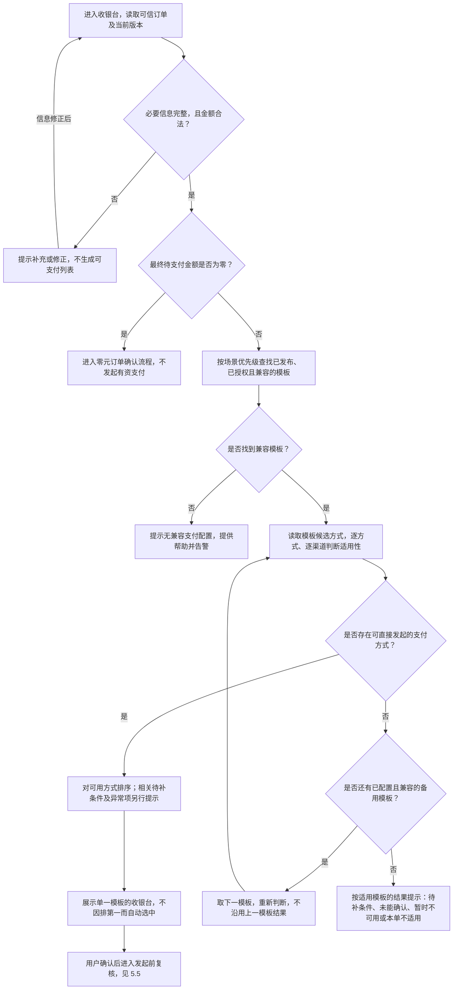
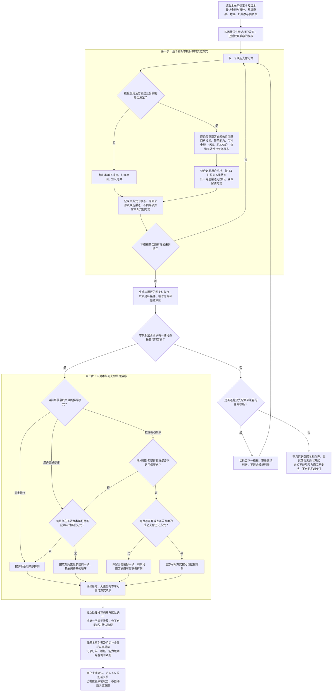
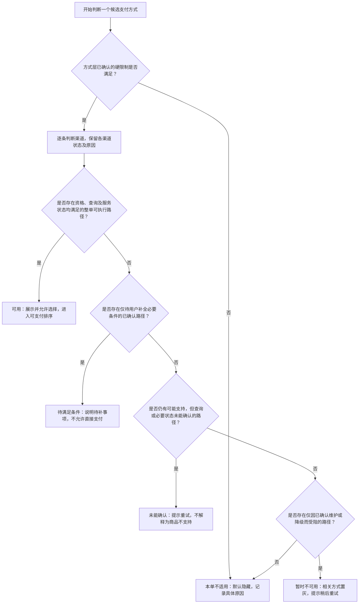
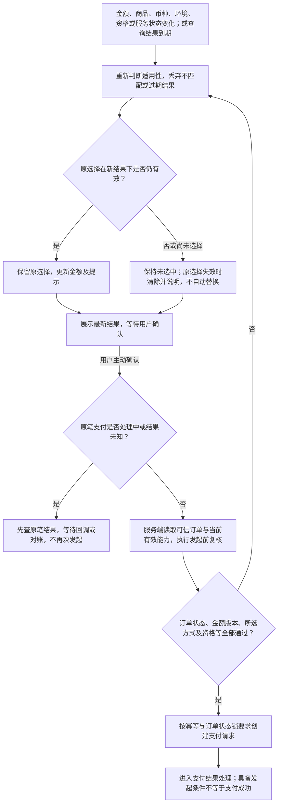
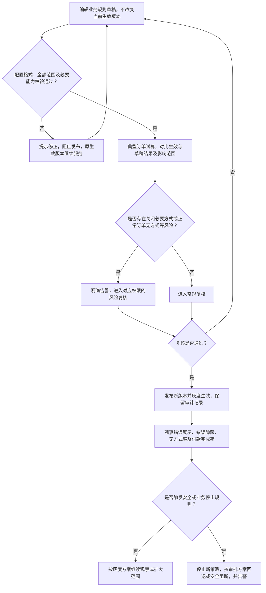

# 收银台支付方式决策 PRD

版本：V1.4 评审稿 · 2026-10-29

一句话说明：每笔订单先确定能用哪些支付方式，再决定展示顺序、标签和默认选择；条件变化或发起支付前重新复核，并解释每一步的结果。

本文将《收银台支付方式排序产品方案》落成完整的单笔订单决策功能，覆盖适用性、排序、备用模板、展示及确认。正式需求与本地 Demo 分开说明；Demo 不表示机构接入、后端或发布能力已经上线。

本文包含五张产品逻辑流程图：订单整体决策（3.3）、单笔订单的支付方式与排序决策（3.4）、支付方式状态汇总（4.1）、条件变化与发起前复核（5.5）、规则发布（6.1）。图表使用 Mermaid 格式，与正文规则配套阅读。

## 一、背景与目标

同一模板可能同时用于 2 元礼包、328 元礼包和自动续费月卡。金额门槛、订阅能力、地区和渠道状态不同，不能展示同一份静态列表，也不应通过复制模板处理每个商品的差异。

1. 一套模板服务多个商品，按当前订单生成适用结果。
2. 提前拦截可判断的限制，减少选择后才发现不能支付的情况。
3. 不把查询失败、服务故障误判成商品不支持，让用户有明确的下一步。
4. 判断可解释、可回放，规则变更可预览、审核和回滚。
5. 适用判断与排序独立，历史偏好和数据评分不能绕过硬限制。

可用只代表具备发起支付的条件，不保证余额充足、授信通过、风控放行或最终支付成功。

## 二、行业参考与采用原则

下表为官方文档中的事实；后续规则为结合本项目提出的设计，不声称三家采用统一状态模型。

| 官方参考 | 已确认做法 | 本产品采用原则 |
| --- | --- | --- |
| [Stripe 动态支付方式](https://docs.stripe.com/payments/payment-methods/dynamic-payment-methods) | 根据金额、币种、客户位置、集成及交易能力等决定符合条件的方式；金额使用含税、优惠后的最终金额 | 按交易判断，不按商品标价放行，模板不是最终清单 |
| [Stripe 展示规则](https://docs.stripe.com/payments/payment-method-rules) | 支持额外展示条件，但有方式和流程限制；文档所述规则不支持银行卡及 Apple Pay / Google Pay | 业务展示规则不等于底层支付能力，不假设覆盖全部支付产品 |
| [Adyen paymentMethods](https://docs.adyen.com/api-explorer/Checkout/latest/post/paymentMethods) | 可传商户账户、金额、币种、付款人国家、终端及允许 / 屏蔽方式，获取本次方式集合 | 主动传完整交易上下文，不拿默认全列表当本单列表 |
| [Antom consult](https://docs.antom.com/ac/ams/consult) | 一次性支付咨询返回支付选项，含 enabled 与 disableReason，区分限额、币种、降级等原因 | 保留机构原始结果并映射内部状态，查询成功不等于支付成功 |

适用范围须单独确认：上述 Antom 页面面向一次性支付，不能证明订阅支持；已核实 Adyen 接口不保证提供每个隐藏方式的原因；Stripe 规则金额折算不代表支持原本不支持的支付币种。缺失能力或原因不得凭空补全。

## 三、产品模型与责任

### 3.1 四层共同判断

| 层次 | 负责什么 | 管理方 |
| --- | --- | --- |
| 模板候选 | 当前场景可以考虑哪些方式、基础顺序 | 获授权运营 |
| 商户与支付能力 | 开通及授权、币种、地区、终端、限额、订阅等交易能力 | 支付 / 合规团队及支付机构 |
| 业务限制 | 商品支付属性、商品分组、场景额外限制 | 商品 / 业务团队及获授权运营 |
| 本次交易与状态 | 最终金额、整单商品、资格、设备环境、渠道健康及查询结果 | 可信订单服务、客户端能力检测和支付系统 |

各层共同成立才可发起，业务只能收窄，不能覆盖平台、合规、商户授权或机构硬限制。终端钱包就绪信息可由客户端补充，不能替代服务端权限及订单校验。IP、语言不能单独决定合规地区或收款资格。

### 3.2 支付方式不等于渠道

一个用户入口可对应多条执行渠道。至少一条完整支持本单、已授权且确认可用，该方式才具备直接发起条件；一条失败不应隐藏整个方式。

例如银行卡主渠道最低 10 元、备用最低 5 元，6 元订单保留银行卡，仅备用可执行。多个渠道的不连续金额区间不能拼成连续区间；多商品必须由同一渠道支持整单，不能拼接各渠道分别支持的商品属性。

同名方式不能直接合并，只有用户体验、授权、费用呈现和协议兼容的路径才可合并为一个入口。适用判断产生候选渠道，不在此阶段完成路由，不自动拆单。

### 3.3 订单整体决策流程

先确认订单，再在已授权且兼容的模板范围内判断支付方式。无可选方式时，只尝试预先配置的兼容备用模板，不临时拼接其他模板的方式。

没有直接可选方式，不等于所有方式都明确不支持。备用模板也不能绕过硬限制；最终提示必须保留未确认或待补条件的事实，不能一律显示“商品不支持”。

### 3.4 每笔订单的收银台支付方式决策流程

本图回答：同一套模板中的所有方式，针对这一笔订单分别得到什么结论，以及最终按什么顺序呈现。以已通过信息及金额校验的有资订单为起点；缺失信息、零元及无兼容模板的处理见 3.3。

每笔订单独立执行，不直接复用上一商品、上一订单或上一账户的列表。判断需要同时带入最终金额与币种、整单商品支付属性、商户及场景授权、交易地区、终端能力和必要用户资格。

本图的几个执行口径：

- “用户偏好”来自合规范围内的成功支付历史，不是用户主动设置；历史方式本单不可用时跳过，不改写成功记录，不将其重新加入列表。
- 数据排序仅调整有充分依据的位置；单项数据缺失保留其已批准位置，整体数据不足则回偏好策略，没有有效历史再回基础顺序。同分或结果接近时保持稳定顺序。
- 待补条件、暂时不可用和未能确认的方式可以按前述展示策略单独提示，但不进入可支付推荐或默认选中；明确不适用默认隐藏。
- 最终展示只采用一套兼容模板。查询结果必须匹配本单及当前版本；同名支付方式也不能在授权、交互或费用不兼容时直接合并。
- Demo 已演示逐单适用性、三种排序、异常回退及一主一备模板尝试；历史、评分及机构结果均为本地虚构数据，不代表真实个性化模型或支付接入。

本次决策应留存以下结果，便于解释及发起前复核：

| 决策结果 | 产品含义 |
| --- | --- |
| 订单事实与版本 | 本次判断对应哪笔订单、哪一版金额和商品内容 |
| 生效模板及规则版本 | 最终使用哪套候选方式与业务限制 |
| 每种方式的状态与原因 | 为什么可选、隐藏、待补条件或无法确认 |
| 各方式的完整可执行渠道 | 保留哪些路径可处理整单，不代表已完成支付路由 |
| 排序模式及最终顺序 | 本单先展示哪项，数据异常时如何回退 |
| 标签与默认选择来源 | 与排序分别解释，不改变支付资格 |
| 查询时间与有效期 | 结果何时失效，何时必须重新判断 |

### 3.5 决策产品功能：从流程到可操作能力

面向运营、支付产品和排障人员提供“配置策略—模拟订单—查看结果—解释原因”的工作台；用户侧只看到清晰的可选方式和必要提示，不暴露内部渠道或评分。每次决策仅回答这一笔订单，不修改模板中的候选清单，也不创建支付。

| 功能 | 操作与产品逻辑 | 结果 |
| --- | --- | --- |
| 确认订单 | 读取最终金额、币种、整单商品、交易地区、终端及必要资格；校验后再进入模板判断 | 非法或缺失事实停止决策；零元订单不进入有资支付 |
| 选择模板 | 按场景既定顺序检查已启用、发布、授权且兼容的模板；当前模板无直接可支付方式，才尝试已配置的备用 | 保留尝试及拒绝原因；最终只使用一套模板，不混合列表 |
| 生成可支付集合 | 对方式和每条渠道逐项判断，按第四章汇总五类状态 | 可用进入排序；其余按隐藏、补条件或异常提示处理 |
| 配置排序策略 | 选择固定、用户偏好或数据驱动模式；维护基础顺序，基础顺序始终作为稳定兜底 | 草稿与生效策略隔离，校验并显式应用新版本后生效 |
| 设置展示规则 | 独立控制推荐标签、成功历史标签、默认选中规则 | 排第一、推荐、默认选中互不等同，均不能改变支付资格 |
| 维持交互稳定 | 用户手动选择后冻结普通数据更新带来的顺序及标签变化；订单、规则、资格或服务状态变化仍重判 | 保留仍有效的选择；失效清除并说明，不自动改选 |
| 解释本次决策 | 展示订单条件、模板尝试、规则及策略版本、适用原因、排序及回退、查询有效期和当前选择归属 | 支持业务验收与排障；生产需受控留存，Demo 只展示内存结果 |
| 发起前复核 | 用户确认时再次校验本单、模板归属、所选方式及查询有效期，并检查原笔状态 | 校验通过仅表示可发起；处理中或未知先查单，不自动重扣 |

#### 3.5.1 三种排序如何生效

只在本单可直接支付的集合非空时执行。集合为空，不生成排序、推荐或默认候选，保留真实异常和补条件提示。

| 排序模式 | 本单排序规则 | 数据缺失或异常 |
| --- | --- | --- |
| 固定排序 | 从模板基础顺序中移除本单不可选项，剩余相对顺序不变 | 不依赖个人历史或评分 |
| 用户偏好排序 | 查找有效成功历史中最近且本单仍可用的一项，最多提前一项；其余沿用基础顺序 | 无有效历史、未授权、游客或历史服务不可用，回固定排序 |
| 数据驱动排序 | 有效历史方式最多保留一项在前；剩余可用项按可信评分排列 | 整体样本不足、评分超时、过期或上下文不匹配，回偏好，再回固定；单项缺分保留其在剩余基础列表中的位置，仅重排可信评分位置 |

历史须为支付系统确认的成功记录，并限定同用户、游戏、场景、交易市场、币种和环境，排除未来时间及失效记录。Demo 用最近 90 天作为演示窗口；生产窗口和授权依据需支付与合规确认，不能从失败尝试或跨账户记录推断偏好。最近一次成功方式本单不可用时，可继续找更早可用记录，但不得把不可用方式重新放回列表。

评分必须匹配本单和模板版本，并满足有效期与整体样本门槛；每项分值还需可信。Demo 采用虚构 0—100 分，仅验证决策，不展示为真实成功率。完全同分沿用基础顺序；生产对接近分数的稳定门槛另行评审，Demo 不模拟置信区间或自动模型更新。

#### 3.5.2 标签与默认选择分别处理

- 推荐标签：只对指定且本单可用的方式展示，不置顶、不自动选中。生产须有真实推荐依据，Demo 的指定项仅演示独立开关，不是运营活动置顶。
- 成功历史标签：确为当前范围内最近一次成功方式时显示“上次成功使用”；跳过不可用历史而采用更早记录时显示“曾成功使用”，不夸大为“常用”。无依据不展示。
- 默认选中：可配置不默认、第一可用项、最近可用成功历史优先（无历史回第一可用项）；默认候选不改变排序，也不代表用户已确认或授权付款。
- 仅在一次收银台首次打开时应用默认选择。Demo 以“应用策略并重开预览”模拟该时点。修改商品、补资格、重查或重新决策时不重新默认，更不能覆盖用户选择。
- 不新增用户主动设置偏好，不支持运营活动置顶，不在本功能完成执行渠道路由。

#### 3.5.3 重新决策与回退

普通评分或历史更新与支付资格变化分开：用户尚未操作时可以更新顺序；手动选择后普通数据更新不打断展示。明确点击“重新决策”可采用新数据，但只保留仍合法且归属同一模板的选择。

订单条件、模板或规则版本、渠道资格及健康状态变化，或查询到期时，立即重新检查，不受展示冻结保护。原方式失效或切换到备用模板时清除选择，即使方式同名也须重新确认，不静默切换收款路径。评分到期只触发排序降级，不等同于机构查询到期；后者会影响能否支付。

备用模板只能在事先授权及兼容范围内尝试，无可支付方式时才继续；找到可支付集合即停止。若全部模板都无直接可选项，保留所有尝试记录，用户预览只采用一套模板的真实提示；Demo 优先呈现含未知结果的模板，其次待补条件、维护、明确无方式，避免把不确定性误报为商品不支持。同优先级保持配置顺序。

正式产品应将决策结果绑定订单及版本、模板和策略快照并受控留存；发起服务重新验证，不信任浏览器日志。Demo 的“本次决策快照”仅为当前内存结果，没有真实订单编号、审计持久化或历史回放服务。

## 四、状态与用户展示

正式接口不能仅返回 available 布尔值。“是否可选”为派生结果，必须保留以下状态及原因来源。

| 内部状态 | 含义 | 用户侧默认处理 | 下一步 |
| --- | --- | --- | --- |
| 可用 | 本单条件满足，至少一条确认可执行渠道 | 展示、可选择 | 用户确认后发起 |
| 本单不适用 | 已明确不满足金额、币种、商品、终端、授权或业务限制 | 默认隐藏 | 诊断解释，修改订单后重判 |
| 待满足条件 | 除可解决的资格条件外，存在支持本单的路径 | 展示但不可直接支付，说明待补事项 | 完成必要资格或授权后重判 |
| 暂时不可用 | 已确认维护、服务降级等临时问题 | 相关方式置灰提示，无关方式可隐藏 | 稍后重试或选择其他方式 |
| 未能确认 | 超时、查询失败、结果过期或订单不匹配 | 不允许支付，明确提示查询异常 | 重查，保留独立确认可用的方式 |

普通填卡、验证码、3DS 等正常支付步骤不属于“方式不可用”。补充条件必须确实可由用户解决，不能通过前端勾选绕过服务端资格检查。

已知硬限制不因查询异常而消失；有已确认备用渠道时保留方式。无可执行渠道但有待补条件路径时提示补条件；剩余可能路径尚未确认时不能断言全部不支持。各渠道完整原因均供后台查看。

用户只看状态和操作，不显示商户账户、内部渠道错误码。后台同时显示方式结论、逐渠道结果和原因来源。

### 4.1 单个支付方式的状态汇总流程

对每条渠道独立检查商户授权、整单商品、币种与金额、终端能力、机构结论、查询有效期、服务状态和必要资格；再汇总为一个支付方式的结果。这里的“路径”指该方式通过同一条渠道完成整单支付的完整条件，不允许拼接渠道能力。

- 已确认的硬限制优先于未知结果：例如已知金额低于全部渠道下限，查询超时也不能将其变为可用。
- 任一完整路径可执行，就保留该方式，不因其他渠道故障隐藏；例如 6 元订单可使用最低 5 元的备用渠道。
- “待满足条件”必须有已确认支持的路径，不能让补实名等操作掩盖查询未知或维护问题；补全、重试后均重新判断，不直接放行。
- 所有渠道结果及各自原因均进入诊断，不能只记录最后汇总状态，也不能猜测机构未提供的原因。

## 五、订单与交互规则

### 5.1 金额与商品

- 使用订单服务确认的最终待支付金额，包括优惠、税费等已计价项目，不由收银台复制计价逻辑。
- 按方式、执行渠道和币种分别比较。不跨币种直接比较或自动换币；生产精度按币种管理，Demo 仅支持 CNY / USD 两位小数。
- 最低 / 最高金额本期包含边界，特殊机构约定以能力规则为准。缺失、负数、超精度、溢出或不合理金额不放行。
- 标价 6 元优惠 4 元，按实付 2 元判断；标价 4.80 元税费 0.20 元，按实付 5 元判断。
- 零元订单走业务确认流程，不发起有资支付，不计为“无支付方式”。
- 优先使用商品类型、支付属性及分组，必要时增加商品例外，不逐个复制模板。
- 订阅、存卡、手动扣款等能力分别判断，一次性可付不代表可自动续费。

### 5.2 展示、排序与选择

流程：确认订单 → 选择兼容模板 → 判断订单及各渠道适用性 → 对可用方式排序 → 用户确认 → 发起前服务端再次校验。

本单不适用不参与排序，待补条件和异常项不参与可支付推荐。固定、成功支付历史推断偏好、数据驱动排序沿用原方案。推荐标签、默认选中、排序和渠道路由独立；不新增用户主动设置偏好或运营活动置顶。

金额、优惠、商品、币种、地区、设备或资格变化时重判；原选择有效则保留，失效则取消并说明，不自动替换。普通排序更新不使填写中的列表跳动。已选方式失效时，即使隐藏也须提示重新选择。

### 5.3 查询、有效期与兜底

1. 正式服务结合机构交易级查询、受控能力库及渠道健康信息，不仅依赖运营手工维护限额。
2. 查询绑定当前订单事实及版本、模板版本、商户账户及环境，记录查询时间和有效期。旧订单响应不得覆盖新订单；能力或状态失效后不得继续使用旧快照。
3. 机构未返回原因时记录“机构未提供原因”，不能猜为金额超限。调用失败与机构明确不可用分开处理。
4. 单机构 / 渠道查询失败隔离影响，保留其他独立确认可用方式；未知路径不能按可用放行。
5. 缓存按商户、上下文及版本隔离，设有效期、撤销与健康检查；不得恢复已停用或未授权渠道。超时和缓存策略由支付团队按风险审批，Demo 不实现缓存降级。
6. 全部明确不适用才显示“本单暂无适用支付方式”；仍有未知则显示“暂时无法确认”并提供重试；全部维护提示服务暂不可用；缺条件则引导补充。
7. 仅尝试场景已配置且兼容的备用模板，每套重新判断，不混合、不跨游戏或币种，不因异常绕过硬限制。Demo 以一主一备演示，不实现真实场景模板配置服务。

### 5.4 发起与资金安全

服务端发起前按可信订单及当前能力再次校验，拒绝过期、版本不匹配或失效选择；机构查询成功不是支付授权成功。正式发起须有幂等、订单状态锁和原笔状态校验。

原笔处理中或结果未知时先查单、处理回调与对账，不得换方式或渠道重扣。Demo 展示阻止再次发起的交互，不实现查单或资金流程。

### 5.5 条件变化与发起前复核流程

订单条件变化时先更新展示及选择；用户点击支付时，再由服务端复核。不能只相信页面先前显示的可用状态。

复核失败后，即使刷新结果仍有可用方式，也须回到用户确认环节，不自动切换或补发支付。原笔结果未明时不走重新发起分支，原笔处理完成后按订单状态决定后续操作。

## 六、后台配置、发布与诊断

| 区域 | 要求 |
| --- | --- |
| 支付能力 | 按商户、渠道及币种展示能力、限额、来源、版本和更新时间，普通运营只读 |
| 业务限制 | 编辑模板候选启停、额外限额和业务范围，只能收窄硬能力 |
| 试算与影响分析 | 对比生效与草稿结果，检查小额、优惠、订阅及无方式订单 |
| 决策记录 | 记录订单版本、模板及能力版本、金额、方式 / 渠道状态、原因来源、可获取的机构原始结果、查询时间和有效期 |

沿用保存草稿、校验、复核、发布、回滚流程。非法范围、必要能力缺失阻止发布；预计使正常订单无方式可用的变更告警并按权限复核，不能为了通过检查放宽硬限制。

草稿与生效版本隔离，非法草稿不能停用既有方式。机构能力更新异常也须隔离相关路径，不能一条错误数据清空全局。生效版本异常时用经审批的有效回退版本或安全阻断，并告警，禁止默默放宽。

### 6.1 业务规则发布流程

以下为正式产品的发布流程。Demo 的“应用草稿到演示”仅模拟本地版本切换，不代表已完成审批、灰度或线上发布。

回退仍须满足当前商户授权和渠道硬限制，不能通过恢复旧版本重新启用已被撤销的能力；原笔查单、回调和对账始终保留。

## 七、配套 Demo

### 7.1 页面与边界

国内 `/domestic/payment/availability-demo` 使用 CNY，海外 `/payment/availability-demo` 使用独立 USD 示例。页面名为“收银台支付方式决策”，四页签，不修改现有真实模板存储。

| 页签 | 本期实现 |
| --- | --- |
| 商品试算 | 定价、优惠、税费、商品类型（含合并订单）、币种、地区、设备、实名资格；成功历史与评分样本；六步决策解释、用户预览、决策快照、模板尝试及逐方式诊断 |
| 决策策略 | 三种排序模式、基础顺序上下调整、独立推荐及成功历史标签、默认选中、已授权备用模板开关；策略草稿隔离、校验、放弃或显式应用并递增版本 |
| 适用规则 | 业务草稿编辑、校验、典型商品前后数量影响预览、显式应用及放弃草稿；应用递增本地版本，非法草稿不影响当前版本 |
| 渠道能力（规则页内） | 只读限额及来源；即时模拟停用、维护、状态未知、查询超时和机构明确不支持本单，独立于业务草稿 |
| 多商品对比 | 采用生效规则、策略和共同条件，每个商品独立模拟查询与排序，标明实际模板与生效排序，不跨订单复用结果 |

全局查询场景：正常、全部超时、返回已过期结果、返回旧订单结果；提供恢复正常查询按钮。单渠道故障须在该渠道处显式恢复，重试不能擅自清除维护状态。模拟完成实名后重判，不自动选中。

本地模拟器产生结构化快照，绑定订单事实、模板版本、商户 / 环境和能力版本；默认有效期 120 秒，到期停止可选，用户可重试；提交时按当前时间复核。调用成功和选项可用分开判断，明确不可用保留原始结果，未提供适用结论则标记未能确认。这只是演示参数，不是生产 SLA；不是实际 HTTP 调用，不仿冒任何机构契约或真实能力同步。

可模拟原笔处理中 / 结果未知并阻止再发起。应用草稿仅复制业务字段，不能将旧草稿渠道状态覆盖实时故障。

排序样本支持：无历史、钱包 B / 银行卡成功历史、过期、跨账户、历史服务不可用；评分支持正常、另一组评分、单项缺分、同分、超时、整体不足及过期。切换样本是运营试算，不是用户主动设置偏好，也不修改真实成功记录。重新决策不会擅自恢复当前模拟故障；恢复查询或单渠道状态需明确操作。

### 7.2 示例结果

默认 CNY、国内网页、已实名、正常查询、初始规则。钱包 A / B 和数字均为虚构示例，不代表真实机构能力。

| 示例 | 最终金额 | 可选择结果 |
| --- | --- | --- |
| 小额礼包 | 2 | 钱包 A / B，银行卡及分期不适用并隐藏 |
| 标准礼包 | 30 | 钱包 A / B、银行卡 |
| 优惠礼包：6 − 4 | 2 | 同小额礼包，不按标价放行 |
| 渠道边界礼包 | 6 | 钱包 A / B、银行卡，银行卡仅备用渠道满足 |
| 大额礼包 | 328 | 四种可选；取消实名后分期展示待满足条件，不可直接选择 |
| 自动续费月卡 | 30 | 仅银行卡 |
| 礼包与月卡合并订单 | 358 | 仅银行卡，同一渠道支持整单 |
| 含税边界：4.80 + 0.20 | 5 | 钱包 A / B、银行卡，备用渠道达到下限 |
| 超限额订单 | 60000 | 本单暂无适用方式 |
| 全额优惠订单 | 0 | 无需支付 |

所有修改仅内存生效，刷新或重置恢复，不写 localStorage、不保存真实订单、不提供线上发布。未实现真实机构接入、资格系统、审批、缓存、自动查询刷新、后端防重、真实订阅或分期期数子选项。演示计价为“定价 − 优惠 + 税费”，优惠不得超过定价；正式金额由订单服务提供。

### 7.3 决策策略验收示例

默认国内网页、正常查询、大额礼包 328 元、已实名，基础顺序为钱包 A → 钱包 B → 银行卡 → 分期。以下均在同一可支付集合上比较，不通过排序改变适用性。

| 操作 | 预期结果 |
| --- | --- |
| 固定模式，成功历史样本选钱包 B | 仍为 A → B → 银行卡 → 分期；历史标签独立展示，不使固定模式变成偏好模式 |
| 改为偏好模式，显式应用 | B → A → 银行卡 → 分期，只提前一个历史方式 |
| 改为数据模式，正常评分，保留钱包 B 历史 | B → 银行卡 → 分期 → A；首项为历史保护，其余由评分决定 |
| 数据模式，无有效历史，正常评分 | 银行卡 → B → 分期 → A |
| 评分超时，有钱包 B 历史 | 回偏好模式 B → A → 银行卡 → 分期，解释回退原因 |
| 评分超时，历史也无效 | 回基础顺序，不影响合法支付集合 |
| 无历史、钱包 B 缺分 | 银行卡 → B → 分期 → A，B 保留原位置；全部同分时回基础顺序 |
| 标准礼包、历史上次钱包 B 更早银行卡，终端改原生 | B 不适用；偏好采用银行卡并标“曾成功使用”，不能标“上次成功使用” |
| 手动选银行卡后切换评分样本 | 原展示顺序冻结；点击重新决策后新评分生效，银行卡仍有效则保留选择 |
| 主模板渠道全部维护，先不开再开启备用 | 先提示维护且不排序；开启后独立判断备用并展示 A / 银行卡，不拼入主模板方式 |
| 已选主模板银行卡后主模板全部维护，备用启用 | 改用备用模板，但原选择清除并提示；重新选择备用银行卡后才可模拟复核 |
| 推荐 A、默认选第一项，使用数据模式 | 推荐只标 A；默认按最终顺序首项，仅显式重开预览应用，二者不强制一致 |

## 八、成功指标与上线

先验证判断正确和异常可恢复，再看转化。排除测试流量；有资 / 零元由可信订单定义，不按判断结果选择性剔除失败订单。

| 指标 | 定义与方向 |
| --- | --- |
| 错误展示率 | 展示为可选的订单—方式组合中，同事实与版本下本应不可选的比例，本功能导致错误目标为 0 |
| 错误隐藏率 | 回放或抽样标注应可用的订单—方式组合中被错误隐藏的比例，记录覆盖及置信范围，不能仅凭失败反推 |
| 无可用方式率 | 有资有效订单中无直接可发起方式的比例，分明确不适用、待补条件、临时故障、未能确认 |
| 查询成功率与耗时 | 成功查询 / 总查询；超时、过期、版本不匹配及耗时分位，查询成功不表示存在可用方式 |
| 金额限制发起拒绝率 | 首次支付尝试因可提前判断的金额限制被拒的比例，预期下降 |
| 订单付款完成率 | 进入收银台的有效有资订单中观察窗内成功付款的比例，重复进入和重试不扩充分母，异常与退出不剔除 |
| 条件补全及异常恢复 | 补条件后可支付比例、查询异常重试恢复比例，结合最终付款结果观察 |
| 可解释性 | 关键拦截可定位规则、来源和版本，未知不得伪造原因 |
| 决策降级率与正确性 | 分别统计评分→偏好、偏好→固定及备用命中；抽样核对是否按约定回退，降级不得扩大可支付集合 |
| 展示与选择稳定性 | 普通数据更新导致手动操作中列表跳动、失效后自动改选及模板静默切换的错误目标为 0 |

上线前冻结基线、样本量、观察窗、延迟预算、非劣效界限和停止规则，先影子决策及订单回放，再灰度，分金额、商品、地区、设备及机构观察。不依据 Demo 承诺转化收益。

资金底线：重复扣款、未授权发起、绕过硬限制、模拟误接生产均为 0；确认事故立即停止新策略，保留原笔查单、回调及对账。

## 九、验收清单

1. 商品变化不复制模板，排序或宽业务限制不能覆盖硬限制。
2. 含税优惠后金额准确，边界包含、最小单位精确；非法、超精度、溢出不放行，零元单独处理。
3. 有一条完整可用渠道则保留方式，不拼接金额间隙和整单能力。
4. 五类状态与展示对应：不适用隐藏，待补条件可操作，未知不解释为不支持。
5. 单渠道查询异常隔离；全部失败显示无法确认；过期、订单或规则不匹配不放行。
6. 结果到期后停止选择，提交时按当前时间和订单重判。
7. 非法草稿不影响生效版本，有效草稿显式应用并递增版本，不覆盖渠道即时状态。
8. 原选择有效保留、失效清除并提示，不自动切换或勾选。
9. 原笔处理中 / 未知阻止再发起，包括直接调用本地校验。
10. 对比逐单查询，国内 / 海外独立；重置恢复，无真实存储或支付写入。
11. 三种模式仅重排本单可支付集合，历史最多提前一项；数据整体异常按偏好、固定逐级回退，缺分与同分保持稳定。
12. 历史限账户及业务范围；无授权、失败、未来、过期或畸形历史不生成偏好；更早记录不误标“上次成功使用”。
13. 排序、标签和默认选择独立；空可支付集合不排序、不推荐、不默认；普通更新不能覆盖手动选择。
14. 备用仅预先配置且兼容者可用，独立查询、不混合；同名方式切换模板清除原选择并要求重新确认。
15. 能查看六步决策、本次事实与版本、查询有效期、模板尝试、实际排序及回退依据；Demo 明示模拟和仅内存边界。

## 十、交付与后续接入

本期：本 PRD、主方案及技术附录同步、Vue Demo、本地计算及模拟查询模块、规则及页面状态测试。

生产前：支付团队确认各机构契约与适用范围、商户及资格来源、服务端交易级判定、可信订单版本、缓存与失效、发起幂等及查单、发布回滚、审计告警和灰度。前端 Demo 不替代这些能力。
